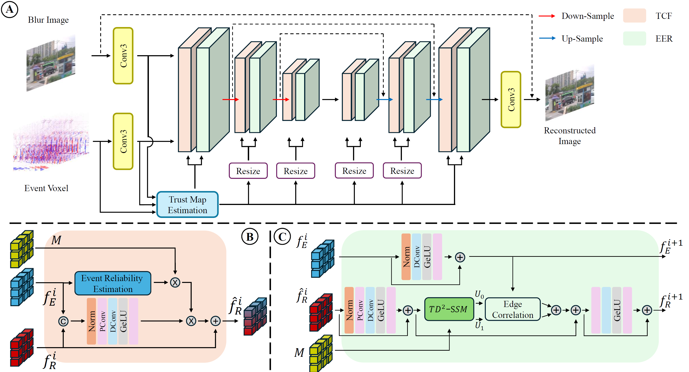

# TESS-Net: Trust and Event-Edge-Guided State Space Deblurring Network

Ahmad Moori, Vasit Sagan, Omar Tahri, Erik Blasch, and Hadi Ali Akbarpour  
**WACV 2027**

## Abstract

> Under fast motion and severe blur, a single RGB observation often loses fine structures and textures, making image-only deblurring fundamentally ill-posed. Event cameras offer complementary high-temporal-resolution measurements during the exposure interval, but effectively exploiting event information remains challenging due to spatially varying reliability and misalignment with blurred image content. In this paper, we propose Trust and Event-edge-guided Selective Scan Network (TESS-Net), an event-guided image deblurring framework based on trust-conditioned state-space models. The key idea is to explicitly estimate a dense trust map from cross-modal structural discrepancies between the blurred RGB image and the event representation, providing a spatial prior that determines where event cues should influence restoration. Guided by a trust signal, TESS-Net integrates two core components: a Trust-Conditioned Fusion Block (TCF) that selectively regulates event-to-RGB feature integration, and a Trust-conditioned Dual-Direction State-Space Module (TD²-SSM) that propagates long-range context in a reliability-aware manner. An Event-Edge Guided Router (EER) further aggregates directional restoration candidates by enforcing consistency with event-derived structural cues. Extensive experiments on both synthetic and real-world event datasets demonstrate that TESS-Net consistently outperforms strong recent baselines, with particularly pronounced gains under severe motion blur.

## Overview

